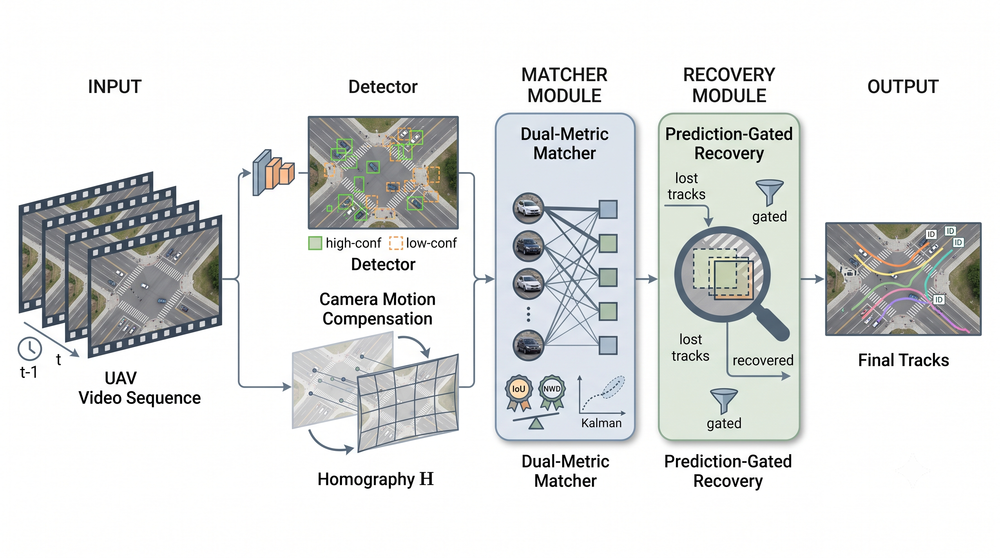

# Multi-Object Tracking for Dynamic Drone Imagery

**Jehwan Choi, Kanghyun Jo**\*
Department of Electrical, Electronic and Computer Engineering, University of Ulsan, Ulsan, South Korea
\* Corresponding author

**Status:** Accepted to IW-FCV 2026 (to appear).

This is the official code release of the paper.

## Summary

On drone footage, platform-driven camera shake and targets only a few pixels in size interact: a residual misalignment of a few pixels leaves a large box nearly unaffected, but it drives the IoU between the predicted box and the detection of a small target to zero, and association fails. This repository implements a **training-free** tracker that adds three modules to ByteTrack.
(i) **CMC**: an ORB + MAGSAC++ frame-to-frame homography warps every Kalman prior.
(ii) **SAAC** (Scale-Adaptive Association Cost) replaces the IoU cost of association stages 1 and 2 with `α(s)·(1−IoU) + (1−α(s))·(1−NWD)`, where `α(s) = clip((s−8)/32, 0, 1)` and `s = sqrt(w·h)` is the track scale.
(iii) **PGR** (Prediction-Gated Recovery) re-runs the same detector on a zoomed crop around the warped prediction of each track that loses its match, then gates the recovered boxes with a buffered IoU.
No module has learned parameters. One fixed set of hyperparameters is used for every benchmark.



## Main results

Numbers are copied from the paper (pooled over all sequences of each benchmark, official TrackEval). Within each benchmark, all trackers use identical primary detections. On **DynUAV** these are the public detection files that come with the DynUAV release (`<seq>/det/det.txt`). On **VisDrone-MOT** they come from a YOLOX-s that the authors fine-tuned on VisDrone-MOT (conf. 0.001, NMS IoU 0.65).

**Comparison with state-of-the-art trackers** (paper Table 1)

| Tracker | DynUAV HOTA | DetA | AssA | IDSW | VisDrone-MOT HOTA | DetA | AssA | IDSW |
|---|---:|---:|---:|---:|---:|---:|---:|---:|
| ByteTrack | 59.7 | 60.6 | 59.3 | 1820 | 40.7 | 34.0 | 49.4 | 1694 |
| OC-SORT | 58.4 | 58.7 | 58.6 | 1725 | 32.3 | 23.0 | 45.8 | 1183 |
| BoT-SORT | 65.4 | 63.4 | 67.9 | 745 | 39.7 | 26.8 | 59.2 | 293 |
| TrackTrack | 58.6 | 59.4 | 58.3 | 1584 | 33.6 | 23.3 | 48.7 | 746 |
| UCMCTrack | 28.9 | 50.6 | 16.6 | 29042 | 18.5 | 18.9 | 18.6 | 18831 |
| **Ours** | **65.6** | **64.8** | 67.0 | **590** | **45.0** | **35.9** | 57.0 | 603 |

**Ablation over CMC, SAAC and PGR** (paper Table 2)

| CMC | SAAC | PGR | config | DynUAV HOTA | DetA | AssA | IDSW | VisDrone-MOT HOTA | DetA | AssA | IDSW |
|:-:|:-:|:-:|---|---:|---:|---:|---:|---:|---:|---:|---:|
| | | | `bytetrack` | 59.69 | 60.60 | 59.26 | 1820 | 40.67 | 33.97 | 49.36 | 1694 |
| | ✓ | | `saac` | 60.29 | 60.92 | 60.12 | 1500 | 40.83 | 34.03 | 49.67 | 1562 |
| | | ✓ | `pgr` | 60.31 | 61.54 | 59.59 | 1511 | 41.18 | 34.54 | 49.79 | 1624 |
| | ✓ | ✓ | `saac_pgr` | 60.95 | 61.78 | 60.62 | 1373 | 41.38 | 34.65 | 50.14 | 1467 |
| ✓ | | | `cmc` | 65.20 | 63.92 | 66.93 | 672 | 44.84 | 35.45 | 57.34 | 596 |
| ✓ | ✓ | | `cmc_saac` | 65.29 | 63.94 | 67.07 | 617 | 44.72 | 35.39 | 57.13 | 603 |
| ✓ | | ✓ | `cmc_pgr` | 65.52 | 64.70 | 66.81 | 638 | 44.87 | 35.82 | 56.86 | 602 |
| ✓ | ✓ | ✓ | `full` | **65.63** | **64.75** | 66.99 | **590** | **44.95** | **35.85** | 57.00 | 603 |

## Repository layout

```
motdd/                 tracker package
  cmc/                 ORB + MAGSAC++ homography, Kalman-prior warp
  association/         NWD and the SAAC cost
  detection/           detector re-invocation on zoomed crops (PGR)
  trackers/            ByteTrack baseline adapter and the MOTDD tracker
configs/
  dynuav/ visdrone/ uavdt/   8 configurations per benchmark (see the ablation table)
  detectors/                 YOLOX-s Exp files of the fine-tuned detectors (used by PGR)
tools/
  run_tracker.py             config + sequences -> MOTChallenge tracker files
  eval_hota.py               pooled HOTA/DetA/AssA/MOTA/IDF1/IDSW with the official TrackEval
  prepare_visdrone_mot.py    VisDrone2019-MOT test-dev -> MOTChallenge layout
  prepare_uavdt_m.py         UAVDT-M -> MOTChallenge layout
third_party/README.md        ByteTrack and YOLOX (not included; exact commits)
figures/                     paper figures
```

## Installation

Tested with Python 3.11, PyTorch 2.5.1 and CUDA 12.1 on Linux.

```bash
git clone <this repository> motdd && cd motdd
conda create -n motdd python=3.11 -y && conda activate motdd
pip install torch==2.5.1 torchvision==0.20.1 --index-url https://download.pytorch.org/whl/cu121   # or the CPU wheels
pip install -r requirements.txt

# ByteTrack and YOLOX at the exact commits used for the paper (see third_party/README.md)
git clone https://github.com/ifzhang/ByteTrack.git third_party/ByteTrack
git -C third_party/ByteTrack checkout d1bf0191adff59bc8fcfeaa0b33d3d1642552a99
git clone https://github.com/Megvii-BaseDetection/YOLOX.git third_party/YOLOX
git -C third_party/YOLOX checkout 6ddff4824372906469a7fae2dc3206c7aa4bbaee

# TrackEval for evaluation (official repository, not vendored)
pip install git+https://github.com/JonathonLuiten/TrackEval.git@12c8791b303e0a0b50f753af204249e622d0281a
```

Neither ByteTrack nor YOLOX needs to be pip-installed: `motdd` puts them on `sys.path` itself. To keep them somewhere else, set `MOTDD_BYTETRACK_DIR` and `MOTDD_YOLOX_DIR`.

## Data preparation

The default layout is shown below. Each root can be moved with `--data-root`, `--det-root` and `--weights-root`.

```
data/
  DynUAV/<seq>/                 img1/  gt/gt.txt  det/det.txt  seqinfo.ini   (11 sequences)
  VisDrone-MOT-test-dev/<seq>/  img1/  gt/gt.txt  seqinfo.ini                 (17 sequences)
  UAVDT-M/<seq>/                img1/  gt/gt.txt  seqinfo.ini                 (20 sequences)
detections/
  VisDrone-MOT/<seq>.txt        primary detections, MOTChallenge format
  UAVDT-M/<seq>.txt
weights/
  yoloxs_visdrone_mot.pth       fine-tuned YOLOX-s (PGR on DynUAV and VisDrone-MOT)
  yoloxs_uavdt_m.pth            fine-tuned YOLOX-s (PGR on UAVDT-M)
```

**DynUAV.** Download the release from the official project page (https://github.com/kxzhang-lab/DynUAV, arXiv:2603.05970). It already uses the MOTChallenge layout and includes the detection files used in the paper (`det/det.txt`). The paper pools 11 sequences: `001 014 018 040` from the validation split and `004 009 016 027 029 055 067` from the test split.

```bash
mkdir -p data/DynUAV
for s in 001 014 018 040;                 do ln -s /path/to/DynUAV/val/$s  data/DynUAV/$s; done
for s in 004 009 016 027 029 055 067;     do ln -s /path/to/DynUAV/test/$s data/DynUAV/$s; done
```

**VisDrone-MOT.** Download `VisDrone2019-MOT-test-dev` from https://github.com/VisDrone/VisDrone-Dataset. Then convert it:

```bash
python tools/prepare_visdrone_mot.py --src /path/to/VisDrone2019-MOT-test-dev --out data/VisDrone-MOT-test-dev
```

**UAVDT-M.** Download the UAVDT benchmark (`UAV-benchmark-M` images and the `UAV-benchmark-MOTD_v1.0` ground truth) from the official UAVDT page (https://sites.google.com/view/grli-uavdt). Then convert the 20 sequences listed in `configs/uavdt/*.yaml`:

```bash
python tools/prepare_uavdt_m.py --images /path/to/UAV-benchmark-M --gt /path/to/UAV-benchmark-MOTD_v1.0/GT \
    --out data/UAVDT-M --seqs M0203 M0205 M0208 M0209 M0403 M0601 M0602 M0606 M0701 M0801 \
    M0802 M1001 M1004 M1007 M1009 M1101 M1301 M1302 M1303 M1401
```

The paper reports results on DynUAV and VisDrone-MOT only. The UAVDT-M configurations are included for completeness.

**Detections and detector weights.** This repository does not include the fine-tuned YOLOX-s weights or the frozen VisDrone-MOT / UAVDT-M detection files used in the paper. Detection files use the MOTChallenge format, one file per sequence, one line per box:
`frame, -1, x, y, w, h, score, -1, -1, -1` (1-based frame index, top-left corner, pixels).
The four configurations without PGR (`bytetrack`, `saac`, `cmc`, `cmc_saac`) do not use the detector weights. On DynUAV they can therefore be run from the public release alone.

## Running the eight configurations

Each benchmark has one config per ablation row: `bytetrack`, `saac`, `pgr`, `saac_pgr`, `cmc`, `cmc_saac`, `cmc_pgr` and `full`. All hyperparameters are fixed and shared across benchmarks:
- ByteTrack: `track_thresh` 0.5, `track_buffer` 30, `match_thresh` 0.8.
- CMC: 1000 ORB features; fewer than 20 MAGSAC++ inliers falls back to the identity.
- SAAC: knots 8 and 40 px, `C` = 12.8.
- PGR: `K` = 4; crop side `max(8·sqrt(area), 128)`; 640×640 letterbox; conf. 0.1; NMS 0.65; `τ_dedup` = 0.5; `r` = 0.2; `τ_gate` = 0.3.

```bash
for c in bytetrack saac pgr saac_pgr cmc cmc_saac cmc_pgr full; do
  python tools/run_tracker.py --config configs/dynuav/$c.yaml   --device cuda
  python tools/run_tracker.py --config configs/visdrone/$c.yaml --device cuda
done
```

Outputs are written to `outputs/<benchmark>/<config>/data/<seq>.txt`. Use `--seqs` to run a subset of sequences.

The association side runs on one CPU thread and is deterministic. Configurations without PGR reproduce the tracker outputs behind the paper's numbers exactly. PGR re-runs the detector. The paper's PGR rows were produced on a GPU in FP16 (`fp16: true`). Running the detector on the CPU (`--device cpu`, FP32) gives slightly different recovered boxes, so the PGR rows can then differ slightly from the tables.

## Evaluation

```bash
python tools/eval_hota.py --config configs/dynuav/full.yaml   --gt-folder data/DynUAV                --trackers-folder outputs/DynUAV
python tools/eval_hota.py --config configs/visdrone/full.yaml --gt-folder data/VisDrone-MOT-test-dev --trackers-folder outputs/VisDrone-MOT
```

`eval_hota.py` calls the official TrackEval (`MotChallenge2DBox`, `DO_PREPROC=False`, HOTA + CLEAR + Identity at IoU 0.5). It pools all sequences of the benchmark (`COMBINED_SEQ`).

## Citation

```bibtex
@inproceedings{choi2026motdd,
  title     = {Multi-Object Tracking for Dynamic Drone Imagery},
  author    = {Choi, Jehwan and Jo, Kanghyun},
  booktitle = {International Workshop on Frontiers of Computer Vision (IW-FCV)},
  year      = {2026},
  note      = {to appear}
}
```

## Acknowledgment

This research was supported by the ANCHOR program through the Ulsan ANCHOR Center, funded by the Ministry of Education (MOE) and the Ulsan Metropolitan City, Republic of Korea (2026-ANCHOR-07-001).

This code builds on [ByteTrack](https://github.com/ifzhang/ByteTrack) (MIT License) and [YOLOX](https://github.com/Megvii-BaseDetection/YOLOX) (Apache-2.0 License). Neither is redistributed here. Evaluation uses [TrackEval](https://github.com/JonathonLuiten/TrackEval).

## License

Copyright (c) 2026 Jehwan Choi, University of Ulsan. All rights reserved. See [LICENSE](LICENSE).

## Contact

Jehwan Choi (cjh1897@ulsan.ac.kr), Kanghyun Jo (acejo@ulsan.ac.kr, corresponding author).
